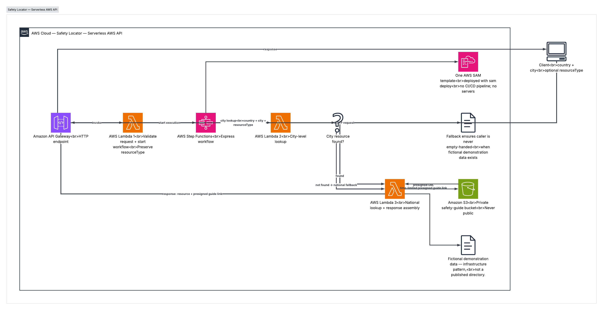

<picture><source media="(prefers-color-scheme: dark)" srcset="https://nextwork.ai/static/nextwork-logo-paper.svg" /></picture>

# Build a Serverless Safety Locator API

**Project Link:** [View Project](https://nextwork.ai/projects/ec268ac4-1527-48d1-a57f-13e608d93d7e)

**Author:** Komeezzy

---

## Defining a Privacy-Conscious Demonstration API

### Fictional data and responsible use

I am building a safety-resource API. The demonstration data stays fictional because we are not able to collect data as the budget is not allowing me.

## Preparing a Windows Serverless Development Environment

### Setting up the local AWS development toolchain

In this step, I'm setting up my Windows PowerShell, Python, AWS SAM, and the AWS sandbox so that I can match your local Python and SAM CLI versions to what the project expects, meaning sam build won't fail with a cryptic error later on a serverless project. Your local runtime has to match what Lambda will run, or packaging breaks before it even reaches AWS.

Confirming your AWS identity now, before you deploy anything, means you don't find out after the fact that you built resources in the wrong account, which could mean unexpected cost, deploying somewhere you don't have the access you think you do, or messing with an account you didn't mean to touch.

### Verifying tools and the AWS sandbox identity

I verified the tools by running versions of them and confirmed that they all worked, although I had to use aws configure for my Access keys.

## Deploying a Public Serverless API

### Deploying the first API Gateway and Lambda integration

In this step, I'm deploying AWS SAM, Amazon API Gateway HTTP API, and AWS Lambda so that I can reduce the amount of failures.

## Building DynamoDB-Powered City Resource Lookups

### Querying city resources and exposing the deliberate lookup miss

In this step, we added an optional resourceType field to the request body (just "hotline" or "local-support"), so that the API can let callers filter for a specific kind of support instead of getting every resource at a location back.

## Making National Fallback Logic Visible with Step Functions

### Orchestrating city lookup and national fallback

In this step, I'm orchestrating an AWS Step Functions workflow that tries a city-level lookup first and automatically falls back to a national-level lookup when the city has no record, so that the API never returns empty just because a specific city isn't in the database yet

### Comparing the city-match and fallback paths

For Harbor City, the workflow's LookupCity step queried DynamoDB and found a matching record, so found was true, and the Choice state sent it straight to ReturnResult with matchedScope: CITY. For Rivertown, the city lookup came back empty, so found was false, and the Choice state's Default branch ran LookupNational instead, which returned the seeded national hotline with matchedScope: COUNTRY. The workflow made the fallback decision visible as an actual branch in Step Functions rather than hiding it inside application code.

## Extending Fallback with Resource-Type Filtering

### Preserving national fallback after a filtered city miss

If that line wasn't there, the filter would get dropped silently on the fallback hop, Rivertown's hotline search would fall back to national but return whatever's there regardless of type, not just hotlines. The filter surviving the handoff is what makes the fallback "fallback to the same kind of help," not just "fallback to anything.

## Reflecting on Serverless Development Skills

### Tools and concepts applied

AWS SAM for infrastructure-as-code (one template.yaml defining every resource instead of clicking through the console). AWS Step Functions Express workflows for making a fallback decision ("try city, then try national") visible and testable instead of hiding it in if statements. DynamoDB composite keys (pk/sk) for modeling two different lookup scopes (city vs. national) in one table. S3 presigned URLs for giving temporary access to private content without ever making a bucket public. And a real lesson about AWS opt-in regions, af-south-1 doesn't behave like us-east-1 by default, you have to be explicit about region and endpoint with some services.

### Project duration and technical challenges

This project took me approximately 2 days. The most challenging part was, honestly, YAML indentation in template.yaml. A resource two spaces off nested it inside the wrong parent and caused a genuinely confusing error ("circular dependency between resources") that had nothing to do with logic, it was purely structural. That and chasing the af-south-1 S3 endpoint bug, since the error message blamed the region, not the code, so it took a minute to realize the fix was in how the S3 client gets created, not in permissions or the bucket config.

### Next steps in cloud development

I did this project today to learn how to... orchestrate a multi-step serverless workflow with AWS Step Functions instead of hardcoding fallback logic inside a single Lambda, and to actually practice IAM least-privilege policies (SAM's policy templates) rather than just attaching broad permissions to make something work.

Another skill I want to learn is... AWS CDK, so I can compare writing infrastructure in actual code (Python/TypeScript) against YAML templates, and get deeper into cloud security specifically, things like GuardDuty, Security Hub, and IAM policy auditing at scale, since that's the direction you're actually building toward.
